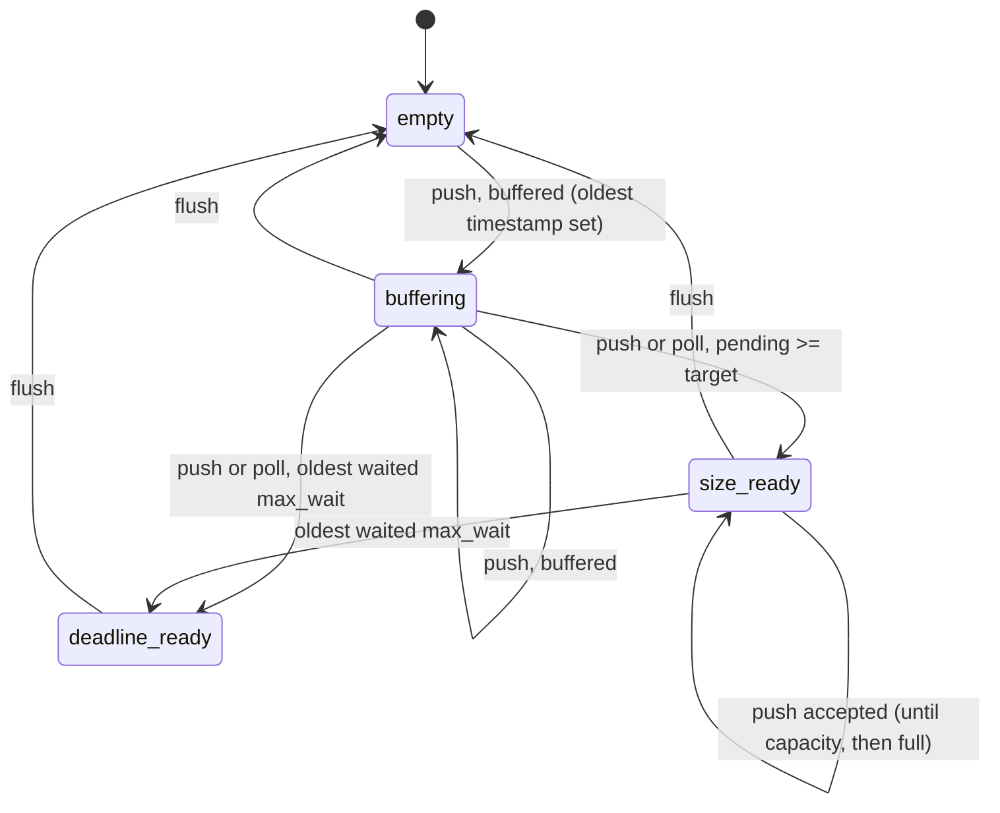
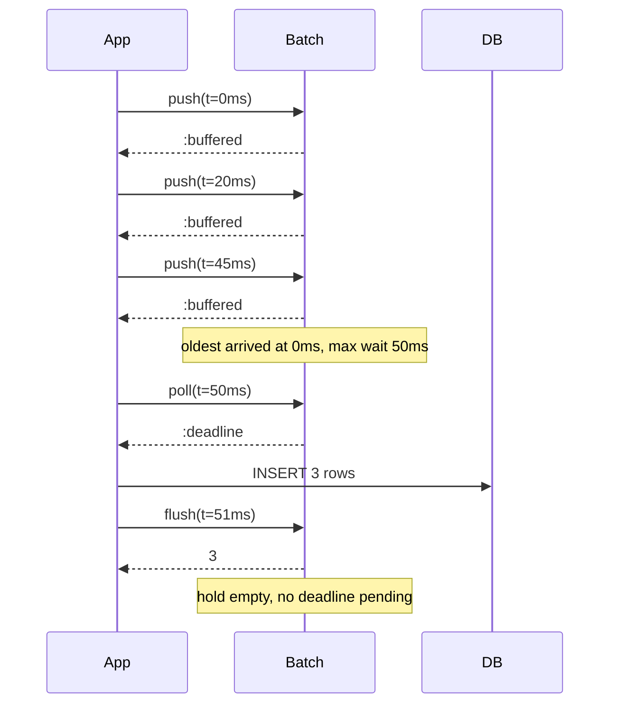

# BatchMachines

> Fewer launches, fuller holds, and nobody left sitting on the pad. 🚚

A batching policy for Ruby. You tell it how big a batch may get and how long the oldest item may wait. Every time something arrives you `push` the clock, and it tells you whether to keep buffering or send now. On your timer you `poll`, and it tells you if the oldest item has waited long enough. When you've sent, you `flush`. It never sees your payloads. It only ever answers one question: is now the time?

## Quick Start

```bash
gem 'batch_machines'
```

```ruby
# Up to 500 rows per insert, and no row waits longer than 50ms.
batch = BatchMachines::Batch.new(500, 50_000_000)
rows = []

def ingest(batch, rows, row)
  rows << row
  case batch.push(now_ns)
  in :buffered             then nil                      # counted, keep going
  in BatchMachines::Flush  then insert_all(batch, rows)  # counted, and it's time
  in :full | :time_regression then rows.pop              # NOT counted
  end
end

def tick(batch, rows)
  case batch.poll(now_ns)
  in :size | :deadline then insert_all(batch, rows)
  in nil | :time_regression then nil
  end
end

def insert_all(batch, rows)
  Row.insert_all(rows)
  rows.clear
  batch.flush(now_ns)
end
```

Time is Integer nanoseconds from a monotonic clock. `now_ns` is whatever you use for that, such as `Process.clock_gettime(Process::CLOCK_MONOTONIC, :nanosecond)`.

## A Message to the Resistance

So the event stream got busy and you were doing one INSERT per event. The database said no. You switched to batches of 500, and throughput went up tenfold. Then support opened a ticket: the last 37 events of every day show up the next morning, because 37 is less than 500 and nothing ever told them to go.

You added a timer. Now there's a batch size *and* a deadline, and a ticket about which one wins when both fire in the same tick, and another about the deadline resetting every time an item arrives so a steady trickle never flushes at all.

This is Nagle's problem from 1984 with the names changed. Group small things into bigger things, but never make the first small thing wait forever. The bookkeeping for that is three numbers: how many are waiting, how many you want before sending, and when the oldest one arrived. This gem keeps those three numbers and makes the call. The sending is still yours.

## Chapter 1: Stardate 2025.186, the AMS Nagle

> **AMS Nagle**, NCC-4202, *Nagle*-class cargo consolidator.
> Fewer launches. Fuller holds. No forgotten departure deadline.

The consolidator doesn't fly. It watches the loading bay. Every pod that rolls in is logged, and the moment the hold reaches target size, or the first pod has sat on the deck for its full wait, the launch order goes out. One launch per pod burns the convoy's fuel. One pod waiting a week burns the mission.

Somewhere in the bay, a loading officer proposes:

```ruby
def enqueue(row)
  buffer << row
  flush_all if buffer.size >= 500
end
```

"That," says the consolidator, "is how thirty-seven pods spend the night on the deck."

## The Flight Plan

Three things can be true of the hold: it has room and no reason to launch, it has reached its target, or the first pod has waited too long. Deadline beats size when both are true.



And a slow evening, with a trickle that never reaches 500:



## How the Hold Works

### Push

Every arrival is a `push` with the current time. The answer tells you what happened and what to do.

```ruby
batch = BatchMachines::Batch.new(2, 10)

batch.push(1)    # => :buffered                   room left, no reason to send
batch.push(2)    # => #<data Flush reason=:size>  target reached, send now
batch.push(3)    # => :full                       capacity reached, this one was NOT counted
batch.pending    # => 2
```

`:buffered` and a `Flush` both mean the item was counted; `Flush#reason` is `:size` or `:deadline`. `:full` and `:time_regression` are refusals: the item wasn't counted and nothing changed, not even the batch's idea of what time it is. After `:full` you need to flush before it can be. Keep your own list of payloads alongside, and only keep the payload when the push was honoured.

Both honoured answers and refusals are truthy. Don't write `if batch.push(now)`; match on the answer.

Items aren't always the same size. `push_weighted(now, cost)` spends `cost` units of capacity instead of one, so a byte budget flushes at a byte target. `pending` counts items, `pending_cost` counts what they spent.

```ruby
batch = BatchMachines::Batch.new(1_000, 50_000_000)   # 1000 bytes per flush
batch.push_weighted(0, 400)    # => :buffered
batch.push_weighted(1, 700)    # => :full     only 600 left
batch.push_weighted(1, 600)    # => #<data Flush reason=:size>
batch.pending                  # => 2
batch.pending_cost             # => 1000
```

### Poll

Nothing arrives, time passes. `poll` asks the same question without adding anything. It answers `nil` when there's nothing to do.

```ruby
batch = BatchMachines::Batch.new(100, 50_000_000)
batch.push(1_000)
batch.push(40_000_000)

batch.poll(50_000_999)   # => nil        oldest has waited 49.999999ms
batch.deadline           # => 50_001_000 sleep until then instead of guessing
batch.poll(50_001_000)   # => :deadline  oldest has waited 50ms
```

The deadline belongs to the oldest item and never moves. A new arrival doesn't push it back, and neither does changing the target. `deadline` is the instant `poll` first says `:deadline`, and `nil` while the hold is empty.

### Flush

When you've sent, say so. `flush` returns how many were waiting and empties the hold.

```ruby
batch.flush(50_001_000)   # => 2
batch.flush(50_001_000)   # => 0
batch.poll(60_000_000)    # => nil
```

Flushing an empty hold is fine and returns zero.

### Deadline wins

When an arrival both fills the target and lands at the deadline, you hear about the deadline. The older reason takes precedence.

```ruby
batch = BatchMachines::Batch.new(2, 10)
batch.push(0)     # => :buffered
batch.push(10)    # => #<data Flush reason=:deadline>
```

### Adapting the target

The target size starts at capacity. If you'd rather it follow conditions downstream, such as insert latency, `retarget` moves it: hand it a number and the target becomes that number, truncated and clamped to `1..capacity`.

```ruby
batch = BatchMachines::Batch.new(100, 50_000_000)
batch.target            # => 100

batch.retarget(10)      # => 10
batch.retarget(-3)      # => 1     never below one
batch.retarget(1000)    # => 100   never above capacity
```

Need memory? Bring a controller. `adapt(pid, error, elapsed)` steps your PID once and retargets to its output. The controller is yours: a `FeedbackMachines::Pid` from [feedback_machines](https://github.com/seuros/feedback_machines), or any object whose `step(error, elapsed)` answers the same way. This gem doesn't depend on that one. It only calls `step`. `elapsed` is the time since the last sample, in nanoseconds.

```ruby
require 'feedback_machines'

pid = FeedbackMachines::Pid.new(
  FeedbackMachines::Gains.new(0, 1.0, 0),    # integral only
  FeedbackMachines::Limits.new(0, 100)
)
batch = BatchMachines::Batch.new(100, 10)

batch.adapt(pid, 5.0, 1_000_000_000)   # => 5
batch.adapt(pid, 5.0, 1_000_000_000)   # => 10
batch.adapt(pid, 5.0, 1_000_000_000)   # => 15
batch.adapt(pid, 5.0, 0)               # => :invalid_duration   nothing stepped, target still 15
```

Lowering the target doesn't drop anything already in the hold. Items past the target still count, and the next push or poll says size until you flush.

```ruby
batch = BatchMachines::Batch.new(5, 10)
batch.push(0)
batch.retarget(2)   # => 2
batch.push(1)       # => #<data Flush reason=:size>
batch.push(2)       # => #<data Flush reason=:size>   counted, still under capacity 5
batch.pending       # => 3
```

## The Rules of the Consolidator

- **Ruby mirrors the Rust core.** `Batch.new(capacity, max_wait)` and every method take their arguments positionally, in the core's order. `Admission::Buffered` is `:buffered`, `Admission::Flush(reason)` is a `BatchMachines::Flush` `Data` with a `reason`, and `FlushReason` is `:size` or `:deadline`.
- **Every answer, by method.**

  | Method | Honoured | Refused |
  | --- | --- | --- |
  | `push(now)` | `:buffered` or a `Flush`; the item is counted either way | `:time_regression`, `:full` |
  | `push_weighted(now, cost)` | `:buffered` or a `Flush`; the item is counted either way | `:time_regression`, `:full` |
  | `poll(now)` | `:size` or `:deadline`, `nil` when nothing is due | `:time_regression` |
  | `flush(now)` | the items that were pending (Integer), `0` for an empty hold | `:time_regression` |
  | `adapt(pid, error, elapsed)` | the new target (Integer) | `:not_finite`, `:invalid_duration`, `:overflow` |
  | `retarget(output)` | the new target (Integer) | `:not_finite` |
  | `capacity`, `max_wait`, `pending`, `pending_cost`, `target` | Integer | never refuse |
  | `deadline` | Integer nanoseconds, `nil` when nothing is pending | never refuses |

  Every refusal has its own symbol; there is no catch-all. `nil` only ever means "nothing due" or "nothing pending".
- **A refusal never raises and changes nothing.** No item counted, no cost held, the target where it was. The clock a refused call carried is not remembered either, so a refused push can't turn your next call into a `:time_regression`.
- **Time only moves forward.** `push`, `poll` and `flush` with a clock earlier than the last honoured one answer `:time_regression`.
- **Flushing an empty hold is honoured** and answers `0`. Do it twice, get `0` twice.
- **Capacity and cost are Integers** in `1...2**32`. Anything else is `TypeError`, zero or out of range is `RangeError`.
- **Time is Integer nanoseconds** in `0...2**64`, instants and spans alike. Floats and strings raise `TypeError`, negative or too large raises `RangeError`. A zero `max_wait` raises `RangeError`: the first item would be late on arrival.
- **The controller is duck-typed.** `adapt` calls `pid.step(error, elapsed)` and expects a Float or one of `:not_finite`, `:invalid_duration`, `:overflow`, which it hands straight back to you. Anything else from `step` is a `TypeError`; an object without `step` is a `NoMethodError`. The error must be a number and `elapsed` an Integer in range, checked before the controller is touched. A refusing controller has not been stepped, so nothing changed on either side.
- **The Rust core has one more push refusal**, `Overflow`, for a clock so late that the deadline doesn't fit. Integer nanoseconds run out long before that, so Ruby never sees it from a push.
- **Frozen means frozen.** `freeze` the batch and `push`, `push_weighted`, `poll`, `flush`, `adapt`, and `retarget` all raise `FrozenError`, before any controller is stepped.
- **No ids, nothing to restore.** The batch hands out no handles. After a restart, build a new one; it starts empty.

## What You Think You're Doing vs Reality

### You Think: "Batch of 500 or 50ms, whichever comes first. Easy."
### Reality: Whichever comes first, measured from when?

Measured from the newest item and a steady trickle never flushes. Measured from the last flush and the first item after a quiet hour waits the full 50ms plus however long the hour was. Measured from the oldest item, with the deadline pinned the moment it lands, and everything behaves. That last one is the only correct answer and it's the only one this gem knows how to give.

## What's Yours

The batch counts. It doesn't hold your rows, doesn't run a timer, and doesn't call the database. You keep the payloads in a list next to it, you call `poll` from whatever tick you already have, and you call `flush` after the send actually succeeded, not before. If the send fails, don't flush. The hold still knows how many are waiting and when the oldest arrived.

## License

MIT License. See [LICENSE.txt](LICENSE.txt) for details.

**Remember: The last thirty-seven events of the day are still events. Someone has to tell them to go.**
