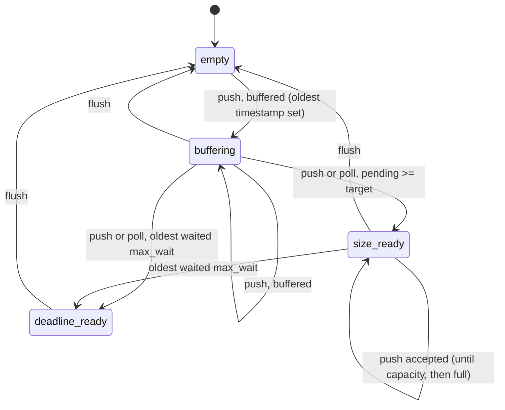
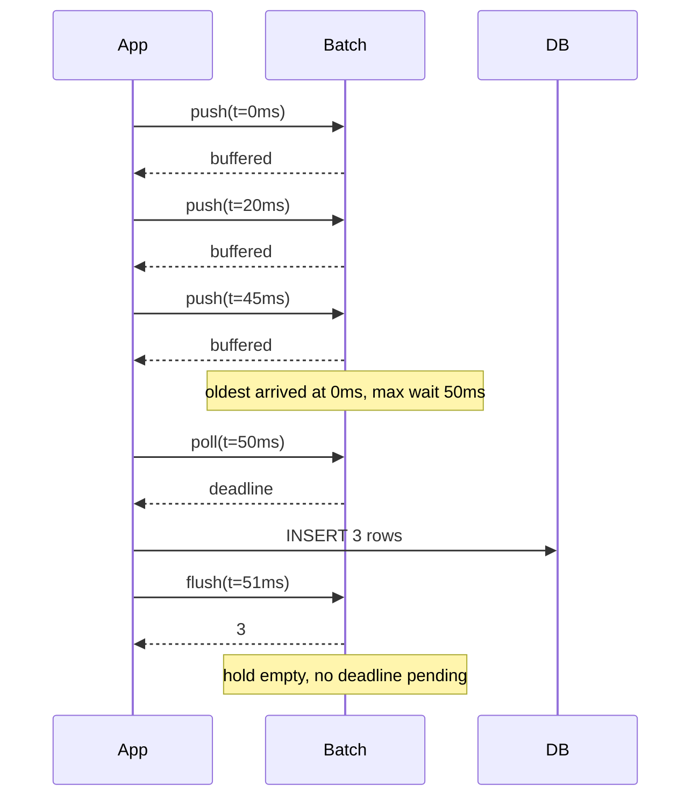

# BatchMachines

> Fewer launches, fuller holds, and nobody left sitting on the pad. 🚚

A batching policy for Ruby. You tell it how big a batch may get and how long the oldest item may wait. Every time something arrives you `push` the clock, and it tells you whether to keep buffering or send now. On your timer you `poll`, and it tells you if the oldest item has waited long enough. When you've sent, you `flush`. It never sees your payloads. It only ever answers one question: is now the time?

## Quick Start

```bash
gem 'batch_machines'
```

```ruby
# Up to 500 rows per insert, and no row waits longer than 50ms.
batch = BatchMachines::Batch.new(500, 50_000_000)
rows = []

def ingest(batch, rows, row)
  rows << row
  case batch.push(now_ns)
  when 'size', 'deadline' then insert_all(batch, rows)
  end
end

def tick(batch, rows)
  insert_all(batch, rows) if batch.poll(now_ns)
end

def insert_all(batch, rows)
  Row.insert_all(rows)
  rows.clear
  batch.flush(now_ns)
end
```

Time is Integer nanoseconds from a monotonic clock. `now_ns` is whatever you use for that, such as `Process.clock_gettime(Process::CLOCK_MONOTONIC, :nanosecond)`.

## A Message to the Resistance

So the event stream got busy and you were doing one INSERT per event. The database said no. You switched to batches of 500, and throughput went up tenfold. Then support opened a ticket: the last 37 events of every day show up the next morning, because 37 is less than 500 and nothing ever told them to go.

You added a timer. Now there's a batch size *and* a deadline, and a ticket about which one wins when both fire in the same tick, and another about the deadline resetting every time an item arrives so a steady trickle never flushes at all.

This is Nagle's problem from 1984 with the names changed. Group small things into bigger things, but never make the first small thing wait forever. The bookkeeping for that is three numbers: how many are waiting, how many you want before sending, and when the oldest one arrived. This gem keeps those three numbers and makes the call. The sending is still yours.

## Chapter 1: Stardate 2025.186, the AMS Nagle

> **AMS Nagle**, NCC-4202, *Nagle*-class cargo consolidator.
> Fewer launches. Fuller holds. No forgotten departure deadline.

The consolidator doesn't fly. It watches the loading bay. Every pod that rolls in is logged, and the moment the hold reaches target size, or the first pod has sat on the deck for its full wait, the launch order goes out. One launch per pod burns the convoy's fuel. One pod waiting a week burns the mission.

Somewhere in the bay, a loading officer proposes:

```ruby
def enqueue(row)
  buffer << row
  flush_all if buffer.size >= 500
end
```

"That," says the consolidator, "is how thirty-seven pods spend the night on the deck."

## The Flight Plan

Three things can be true of the hold: it has room and no reason to launch, it has reached its target, or the first pod has waited too long. Deadline beats size when both are true.



And a slow evening, with a trickle that never reaches 500:



## How the Hold Works

### Push

Every arrival is a `push` with the current time. The return value is a String telling you what to do.

```ruby
batch = BatchMachines::Batch.new(2, 10)

batch.push(1)    # => "buffered"   room left, no reason to send
batch.push(2)    # => "size"       target reached, send now
batch.push(3)    # => "full"       capacity reached, this one was NOT accepted
batch.pending    # => 2
```

`"buffered"`, `"size"`, and `"deadline"` all mean the item was counted. `"full"` means it wasn't, and you need to flush before it can be. Keep your own list of payloads alongside, and only append when the push was accepted.

### Poll

Nothing arrives, time passes. `poll` asks the same question without adding anything. It answers `nil` when there's nothing to do.

```ruby
batch = BatchMachines::Batch.new(100, 50_000_000)
batch.push(1_000)
batch.push(40_000_000)

batch.poll(50_000_999)   # => nil         oldest has waited 49.999999ms
batch.poll(50_001_000)   # => "deadline"  oldest has waited 50ms
```

The deadline belongs to the oldest item and never moves. A new arrival doesn't push it back, and neither does changing the target.

### Flush

When you've sent, say so. `flush` returns how many were waiting and empties the hold.

```ruby
batch.flush(50_001_000)   # => 2
batch.flush(50_001_000)   # => 0
batch.poll(60_000_000)    # => nil
```

Flushing an empty hold is fine and returns zero.

### Deadline wins

When an arrival both fills the target and lands at the deadline, you hear about the deadline. The older reason takes precedence.

```ruby
batch = BatchMachines::Batch.new(2, 10)
batch.push(0)     # => "buffered"
batch.push(10)    # => "deadline"
```

### Adapting the target

The target size starts at capacity. If you'd rather it follow conditions downstream, such as insert latency, feed `adapt` an error signal and it moves the target for you, clamped to `1..capacity`. Out of the box it's a proportional controller with gain 1, so the target simply follows the number you give it. The second argument is how much time passed since the last call, in nanoseconds.

```ruby
batch = BatchMachines::Batch.new(100, 50_000_000)
batch.target                         # => 100

batch.adapt(10, 1_000_000_000)       # => 10
batch.adapt(-3, 1_000_000_000)       # => 1     never below one
batch.adapt(1000, 1_000_000_000)     # => 100   never above capacity
```

Need memory? `configure_pid(p, i, d)` sets the gains. With only an integral gain the target climbs a little more each call:

```ruby
batch = BatchMachines::Batch.new(100, 10)
batch.configure_pid(0, 1.0, 0)

batch.adapt(5.0, 1_000_000_000)   # => 5
batch.adapt(5.0, 1_000_000_000)   # => 10
batch.adapt(5.0, 1_000_000_000)   # => 15
```

Lowering the target doesn't drop anything already in the hold. Items past the target still count, and the next push or poll says `"size"` until you flush.

```ruby
batch = BatchMachines::Batch.new(5, 10)
batch.push(0)
batch.adapt(2.0, 1_000_000_000)   # => 2
batch.push(1)                     # => "size"
batch.push(2)                     # => "size"   accepted, still under capacity 5
batch.pending                     # => 3
```

## The Rules of the Consolidator

- **Capacity is an Integer** in `1...2**32`, and `max_wait_ns` is a positive Integer. Zero for either raises `ArgumentError`.
- **Time is unsigned 64-bit Integer nanoseconds.** Floats and strings raise `TypeError`, negative or overflow raises `RangeError`.
- **Time only moves forward.** A `push` with an earlier clock than the last one returns `"rejected"` and counts nothing. `poll` and `flush` with an earlier clock return `nil` and change nothing.
- **Gains are finite and non-negative.** Infinite, NaN, or negative gains raise `ArgumentError`. An error of infinity or NaN raises too, and `adapt` with zero elapsed raises.
- **A blown-up controller returns `nil`** and leaves the target where it was, rather than handing you a nonsense size.
- **Frozen means frozen.** `freeze` the batch and `push`, `poll`, `flush`, `adapt`, and `configure_pid` all raise `FrozenError`.

## What You Think You're Doing vs Reality

### You Think: "Batch of 500 or 50ms, whichever comes first. Easy."
### Reality: Whichever comes first, measured from when?

Measured from the newest item and a steady trickle never flushes. Measured from the last flush and the first item after a quiet hour waits the full 50ms plus however long the hour was. Measured from the oldest item, with the deadline pinned the moment it lands, and everything behaves. That last one is the only correct answer and it's the only one this gem knows how to give.

## What's Yours

The batch counts. It doesn't hold your rows, doesn't run a timer, and doesn't call the database. You keep the payloads in a list next to it, you call `poll` from whatever tick you already have, and you call `flush` after the send actually succeeded, not before. If the send fails, don't flush. The hold still knows how many are waiting and when the oldest arrived.

## License

MIT License. See [LICENSE.txt](LICENSE.txt) for details.

**Remember: The last thirty-seven events of the day are still events. Someone has to tell them to go.**
